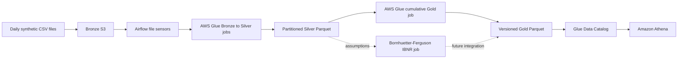
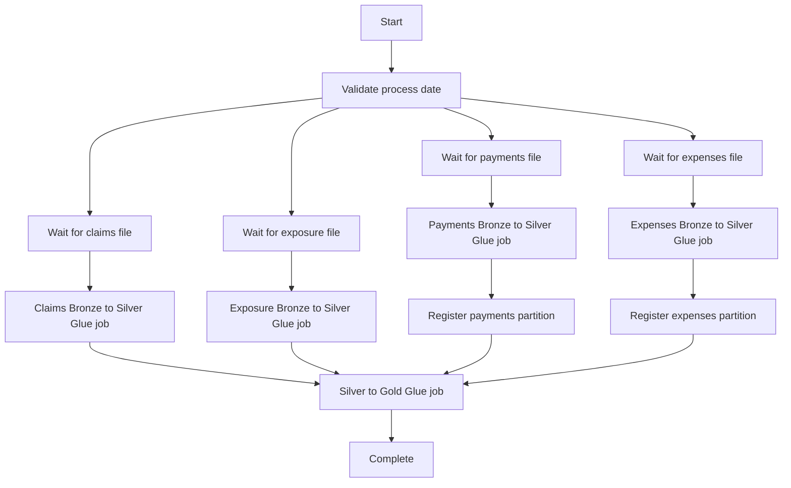

# Auto Insurance Lakehouse Pipeline

An end-to-end data engineering project for synthetic auto-insurance analytics. The pipeline loads four daily operational datasets into Amazon S3, transforms them with AWS Glue, orchestrates processing with Apache Airflow, and publishes policy and portfolio profitability tables that can be queried in Amazon Athena.

All policy, claim, payment, exposure, and expense records in this project are synthetic.

## Business problem

How can an insurer compare earned premium with reported claims and expenses without double-counting claim updates or cash payments? This synthetic case study creates cumulative policy and portfolio views to support underwriting monitoring, expense visibility, and payment reconciliation. It demonstrates analytical capability; it does not establish a real insurer's performance or a measured business improvement.

## Data model

| Dataset | Grain | Purpose |
|---|---|---|
| `claims_events` | Claim source event/version | Claim inserts and updates, reported incurred and paid balances |
| `daily_exposure` | Policy-day | Earned exposure and earned premium denominators |
| `claim_payments` | Payment transaction | Claim cash-payment ledger and paid-loss reconciliation |
| `expense_transactions` | Expense transaction | Direct claim/policy costs and unallocated portfolio/corporate costs |

Expenses with `CLAIM` or `POLICY` scope may be associated with a policy. `PORTFOLIO` and `CORPORATE` expenses remain at aggregate level and are not arbitrarily allocated to clients.

Claims resolve to the highest `source_version` per `claim_id`, then latest `source_updated_at`. Exposure accumulates by policy and `load_date`; that partition date serves as the exposure day. Payments join on claim and policy, while expenses retain their declared scope. Policy attributes in Gold come from the latest exposure row, not an effective-dated policy master.

## Reliability controls

| Control | Implementation and boundary |
|---|---|
| Date and input readiness | [Airflow DAG](airflow/dags/auto_insurance_bronze_to_silver.py) validates the date, waits for four exact S3 keys, retries tasks twice by default, and permits one active run. Gold requires every Silver date in the cumulative window. File presence does not prove source completeness. |
| Validation and replay | [Silver scripts](Scripts/) type and validate fields, quarantine invalid rows, and overwrite the requested date partition. Claims select one version per event ID; exposure duplicates are quarantined; payment/expense exact duplicates collapse and conflicting IDs are quarantined. |
| Economic consistency | [Gold job](Scripts/silver_to_gold_auto_insurance.py) rejects conflicting business keys, unsupported claim operations, invalid economics, and payment/claim/policy/date mismatches. It flags paid-ledger differences, negative case outstanding, and missing exposure attributes; these flags do **not** prevent publication. |
| Publication | Gold writes unique output generations and checks catalog schema compatibility before publishing date partitions and a final manifest. Updates across four catalog tables are **not atomic**; downstream consumers must check successful job completion and the manifest, including matching run IDs. |

Paid cash is reconciled against the source claim balance and is not subtracted again from incurred loss. Policy contribution deducts direct costs; portfolio result also deducts portfolio and corporate overhead.

## Key findings: January 1–10, 2026

The project records a successful daily Airflow/Glue backfill for January 1–10 and the following Athena result for `as_of_date='2026-01-10'`. These are author-reported run results: the repository contains the calculation code and queries, but no saved query exports, execution logs, or run manifests to independently verify this execution.

| Metric | Result |
|---|---:|
| Policies | 10,000 |
| Earned exposure | 269.57966240 policy-years |
| Earned premium | $337,256.18 |
| Reported claims | 49 |
| Reported incurred loss | $554,712.31 |
| Claim-payment ledger | $5,424.14 |
| Direct expense | $25,462.84 |
| Portfolio expense | $7,500.00 |
| Corporate expense | $1,800.00 |
| Total expense | $34,762.84 |
| Reported result before IBNR | -$252,218.97 |
| Reported loss ratio | 164.48% |
| Expense ratio | 10.31% |
| Reported combined ratio | 174.79% |
| Unreconciled claims | 0 |

Gold row counts for that valuation were 49 claim snapshots, 10,000 policy rows, one portfolio row, and 17 expense-summary rows. These values describe synthetic data over a short and immature reporting period; they are pipeline demonstration results rather than actuarial benchmarks.

The reported incurred loss exceeds earned premium by $217,456.13; adding $34,762.84 of expenses produces the reported $252,218.97 deficit before IBNR. The 174.79% combined ratio describes this synthetic window only. Zero unreconciled claims means the source paid balance matches the payment ledger under the implemented check; it does not establish that all claims were reported or reserves are adequate.

## Limitations and evidence gaps

- **Synthetic, immature history:** ten days cannot establish sustainable profitability, pricing adequacy, fraud detection performance, or a credible loss-development pattern. No measured revenue uplift, cost saving, runtime, scalability benchmark, or production SLA is evidenced here.
- **Reported results versus retained evidence:** the numeric results, four output row counts, and successful January 1–10 execution above are documented but not independently supported by committed run artifacts. The formulas are inspectable; their arithmetic consistency is not proof of execution.
- **Partial reproducibility:** full raw inputs, a synthetic-data generator/seed, deployed Glue job definitions, IAM provisioning, and complete infrastructure automation are not included. The statement that the full dataset remains locally and in S3 is an author assertion, not verifiable from Git. A clean clone cannot recreate the exact baseline unaided.
- **Accounting and history boundaries:** Gold v1 supports CAD payments/expenses; claim and exposure schemas do not carry currency, so their CAD basis is assumed. No IBNR, tax, investment income, or overhead allocation to policies is included. Claims use INSERT/UPDATE only; deletes require a reversal model. Exposure uses load date rather than a separate business date, limiting late-arrival handling. Partition presence and quarantine do not establish upstream completeness.
- **Planned work:** effective-dated policy changes and compatible schema migration remain experiments. A separate Bornhuetter-Ferguson script exists, but it is outside the main DAG and needs reviewed assumptions; no validated IBNR result is claimed. See [experiments](docs/experiments.md).

## Reproducibility

1. Obtain the original four daily CSV datasets for January 1–10 to reproduce the reported baseline, or supply schema-compatible synthetic inputs and expect different results. Use the Bronze naming conventions below.
2. Provision the S3 buckets, IAM permissions, Glue jobs and Silver catalog tables referenced by the [DAG](airflow/dags/auto_insurance_bronze_to_silver.py) and [resource list](information.md). Deploy the matching scripts; payment, expense, and Gold operators rely on existing job settings. The DAG uses `ca-central-1` and `aws_default`.
3. Follow the local Airflow setup below. Trigger January 1 through January 10 in ascending order, waiting for each run to succeed before submitting the next. `max_active_runs=1` limits concurrency but does not itself enforce chronological submissions.
4. Verify all four Silver date partitions and inspect quarantine outputs. After Gold succeeds, retain its `_manifests/as_of_date=2026-01-10/latest.json`, Glue run IDs, Airflow task states, and Athena query exports for an auditable result.
5. Run [gold_queries.sql](sql/gold_queries.sql) against one valuation date. Compare the reported table and row counts above, and investigate reconciliation or missing-exposure flags. Gold also includes a Spark self-test through `--TEST_MODE=true` with `--PROCESS_DATE` and `--HISTORY_START_DATE`; it performs no S3/catalog writes and does not validate the deployed end-to-end pipeline.

## Technical reference

### Architecture



The Airflow DAG processes one `process_date` per run. Its four Silver branches run independently after their corresponding Bronze files arrive. Gold begins only when all four branches succeed. For a historical backfill, dates are submitted sequentially so each Gold result represents the cumulative period from `2026-01-01` through that run's process date.

### Airflow DAG execution graph



One DAG run processes one date. The four dataset branches can run in parallel, but the cumulative Gold job waits for all four branches. Payment and expense partitions are registered explicitly because those existing Glue jobs write Parquet but do not update the Data Catalog. The claims and exposure jobs use their existing catalog-management behavior, so the DAG does not add duplicate registration tasks for them.

### Processing layers

#### Bronze

Bronze contains date-addressable CSV objects such as:

```text
s3://bronze-auto-insurance/claims-events/claim_events_2026-01-10.csv
s3://bronze-auto-insurance/daily-exposure/daily_exposure_2026-01-10.csv
s3://bronze-auto-insurance/claim-payments/claim_payments_2026-01-10.csv
s3://bronze-auto-insurance/expense-transactions/expense_transactions_2026-01-10.csv
```

#### Silver

The Glue jobs validate fields, standardize types, quarantine invalid records, handle duplicates within a load date, and overwrite only the requested partition:

```text
s3://silver-auto-insurance/<dataset>/load_date=YYYY-MM-DD/
s3://silver-auto-insurance/quarantine/<dataset>/load_date=YYYY-MM-DD/
```

#### Gold

The cumulative Gold job resolves the latest claim version, reconciles payments, separates direct costs from overhead, and publishes immutable output generations. Glue Catalog partitions point consumers to the successful generation for each `as_of_date`.

| Gold table | Grain |
|---|---|
| `claim_snapshot` | Latest economic version of each claim |
| `policy_performance` | Policy profitability and underwriting measures |
| `portfolio_performance` | Portfolio-wide premium, loss, expense, and combined ratios |
| `expense_summary` | Expense scope/category/region summary |

Paid cash is a reconciliation measure. It is not deducted again from profitability because reported incurred loss already contains paid loss plus case outstanding.

## Repository layout

```text
Scripts/
  bronze_to_silver_claim_events.py
  bronze_to_silver_daily_exposure.py
  bronze_to_silver_claim_payments.py
  bronze_to_silver_expense_transactions.py
  silver_to_gold_auto_insurance.py
  silver_to_gold_ibnr_bf.py
airflow/
  dags/auto_insurance_bronze_to_silver.py
  Dockerfile
  docker-compose.yaml
  .env.example
docs/
  experiments.md
examples/
  policy_changes/
  schema_evolution/
sql/
  gold_queries.sql
```

Generated raw files, Airflow logs/configuration, Python caches, and the real `.env` file are intentionally excluded from Git. The complete generated dataset remains in local storage and S3. This keeps credentials and machine-generated data out of source control while retaining transformation and orchestration code; exact baseline reproduction still requires the inputs and AWS setup described above.

## Local Airflow setup

Requirements:

- Docker Desktop
- AWS credentials configured in `~/.aws`
- Access to the project S3 buckets and Glue jobs

Create the local environment file:

```bash
cd airflow
cp .env.example .env
```

Replace the placeholder Fernet key, build the local image if needed, and start Airflow:

```bash
docker compose build
docker compose up airflow-init
docker compose up -d
```

The Airflow interface is available at `http://localhost:8080`.

Trigger one date:

```bash
docker compose exec -T airflow-scheduler \
  airflow dags trigger auto_insurance_bronze_to_silver \
  --run-id manual_2026-01-10 \
  --conf '{"process_date":"2026-01-10"}'
```

The DAG uses `schedule=None`, so it runs only when triggered. Historical dates are not discovered automatically. A scheduler or backfill launcher must explicitly create each date's run.

## Athena

Example analysis queries are in [`sql/gold_queries.sql`](sql/gold_queries.sql). Always filter Gold tables to exactly one `as_of_date`; summing multiple cumulative snapshots would double-count results.

## Planned demonstrations

The next experiments are defined in [`docs/experiments.md`](docs/experiments.md):

1. Apply an effective-dated policy update without rewriting history.
2. Introduce a new claim-payment column and demonstrate both a controlled schema failure and a backward-compatible migration.
3. Run the Bornhuetter-Ferguson IBNR model with reviewed assumptions and reconcile it to the reported Gold result.

The IBNR job is deliberately separate from the production Gold DAG until its expected loss ratio and development pattern are reviewed. It estimates broad incurred-but-not-reported development, including IBNER, by accident month. It does not allocate IBNR to individual policies.
